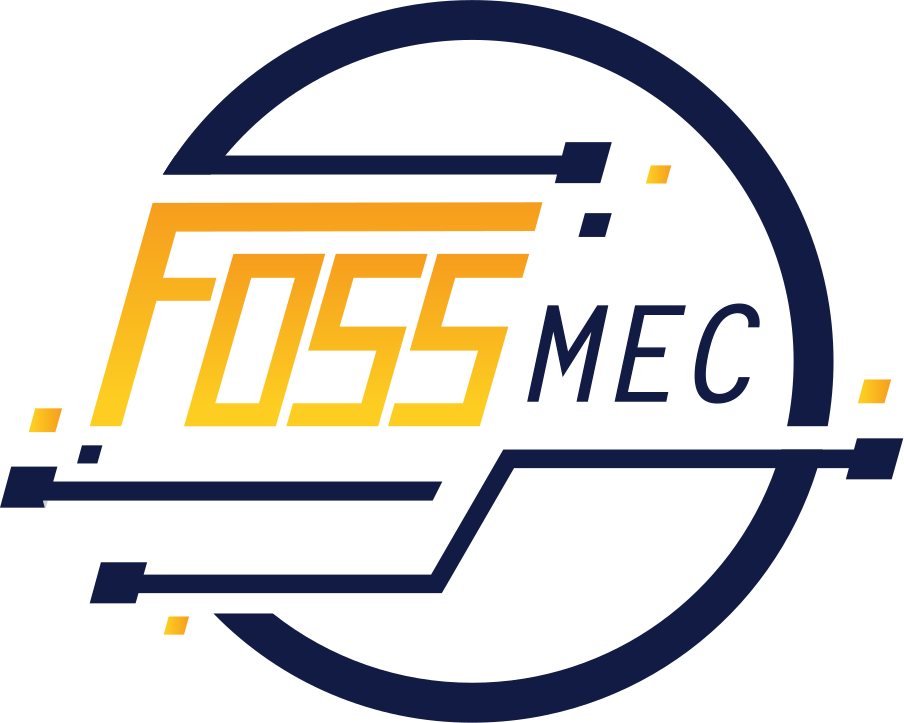

  

    
  

  
FOSS MEC · Model Engineering College

  <h1>Open notes. Open source. Open to everyone.</h1>
  
A permanent knowledge library for MEC: permission-cleared study material,
  verified open resources, and starter guides maintained by FOSS MEC.

  

    <a class="button button--primary" href="academics/">Browse notes</a>
    <a class="button button--ghost" href="resources/">Explore open resources</a>
    <a class="button button--ghost" href="guides/">Read guides</a>
    <a class="button button--ghost" href="https://github.com/FossMec/foss-mec-library/issues/new?template=suggest-resource.yml">Suggest a resource</a>
  

  
<strong>Status:</strong> this library is new. The academic sections show an honest empty state
  until verified, permission-cleared material is accepted. The Git, Linux and workshop pages are
  starter drafts, not student submissions, and are open to correction.

Start here

  <a class="card" href="academics/">
    Study
    Academic materials
    Semester-wise notes, slides and question banks shared with permission.
    Browse by semester →
  </a>
  <a class="card" href="resources/">
    Reference
    Open learning resources
    Curated, free and official links for Git, Linux, programming and more.
    Open the directory →
  </a>
  <a class="card" href="guides/">
    Learn
    Community guides
    Starter guides on Git, GitHub and Linux, maintained in this repository.
    Read the guides →
  </a>
  <a class="card" href="workshop/">
    Workshop
    Let's Git It
    Workshop material, browser-only contribution exercises and a Git cheat sheet.
    Start the workshop →
  </a>

## What is in the library

The library is deliberately small and human-reviewed. Everything is plain Markdown in one
repository, so it stays searchable, portable and easy for the next team to maintain.

| Section | What you will find | Formats |
| --- | --- | --- |
| [Academic Materials](academics/) | Original notes and study material, organised by semester and subject | Notes PDF Slides |
| [Open Learning Resources](resources/) | Links to official documentation, open books, courses and repositories | Docs Book Course Video |
| [Community Guides](guides/) | Long-form tutorials on Git, GitHub and the Linux command line | Notes |
| [Let's Git It](workshop/) | Workshop exercises and a printable Git cheat sheet | Notes |

> **Note — search covers the words on the page, not inside PDFs.**
> mdBook search indexes rendered Markdown. A PDF or slide deck is discoverable only through the
> listing page that describes it, so every material listing includes a title, subject, keywords
> and a short description.

## How contributions work

This is a read-only website backed by GitHub. There is no upload form, account system or
database — suggestions and files travel through GitHub Issues and pull requests, where a
maintainer can review them before publication.

  <a class="card" href="contribute/add-notes.md">
    Path A
    Write notes in Markdown
    Best for original explanations, guides and glossary entries.
    Add written notes →
  </a>
  <a class="card" href="contribute/upload-file.md">
    Path B
    Upload a PDF or slides
    For material you wrote or are explicitly allowed to share.
    Upload a file →
  </a>
  <a class="card" href="contribute/suggest-resource.md">
    Path C
    Suggest an external resource
    Send a free, official link for a maintainer to review and add.
    Suggest a resource →
  </a>
  <a class="card" href="https://github.com/FossMec/foss-mec-library/issues/new?template=report-broken-link.yml">
    Path D
    Report a broken link
    Tell us about a dead, outdated or wrongly described resource.
    Report an issue →
  </a>

  
<strong>Everything is done in a browser.</strong> You need a free GitHub account, but you do
  not need to install Rust, mdBook, Git or an editor to contribute.

  
<a href="contribute/">Read the full contribution guide →</a>

## Built for the next team

- **One book, not many sites.** New subjects and guides become chapters, not new deployments.
- **No runtime dependencies.** The site is static HTML, CSS and JavaScript generated by mdBook.
- **Reviewed before publishing.** Every change lands through a pull request and an automatic build.
- **Licensed content only.** Contributors confirm they wrote the material or have permission to share it.

The source lives at [github.com/FossMec/foss-mec-library](https://github.com/FossMec/foss-mec-library).
Every page has a **Suggest an edit** pencil in the top bar that opens its exact Markdown file.
